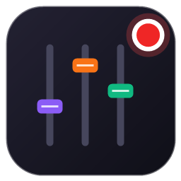

<h1 align="center">Live Régie</h1>

La régie compagnon de <b>TikTok LIVE Studio</b> sur PC — pour le live « Et si… Briser le Silence ».

---

**Live Régie** pilote, depuis une seule fenêtre :
- les **scènes** du live : thèmes (branches), fonds, titres, vidéos, articles, sondages ;
- les outils de **sécurité** : numéros d'aide, bouclier anti-raid, avertissement de sujet sensible, file privée des demandes d'aide ;
- le **chat** : questions épinglées, remerciements automatiques, reconnexion automatique ;
- le **rythme** de l'émission : chrono de débat, jingles, journal du live.

## Documentation

| Document | Pour qui |
| :--- | :--- |
| 📘 [Guide utilisateur](docs/GUIDE_UTILISATEUR.md) | Utiliser la régie au quotidien : préparer, animer et clôturer un live |
| 📜 [Documentation technique](docs/DOCUMENTATION_TECHNIQUE_STUDIO_TIKTOK.md) | Architecture, fichiers, compilation, publication d'une version |
| 🗒️ [Journal des versions](CHANGELOG.md) | Ce qui change d'une version à l'autre |

## Démarrage rapide

1. Double-clique sur le raccourci **Live Régie** (sinon, `Lancer_Studio_TikTok.bat`).
2. Dans TikTok LIVE Studio, ajoute la scène `http://127.0.0.1:8765/stage` (9:16) ou `http://127.0.0.1:8765/stage_16_9` (16:9).
3. Pour le chat : `pip install TikTokLive` (une seule fois), puis **⚡ Connecter au Live** dans l'onglet *Sondages & Chat*.

Windows 10/11 • Rust (egui) • HTML/JS • Python
