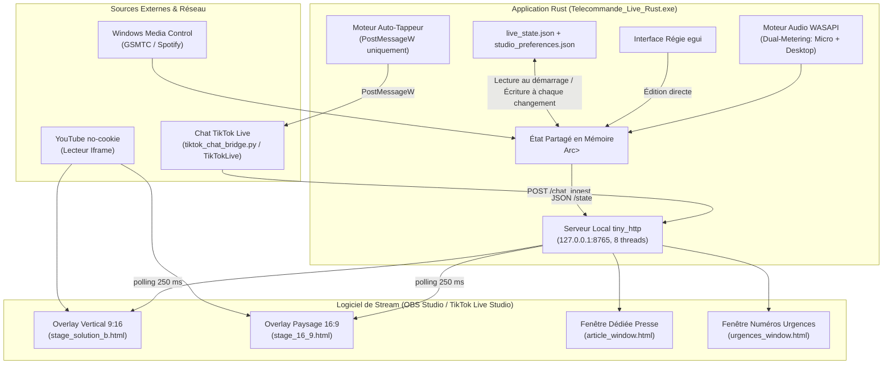

# 📜 DOCUMENTATION TECHNIQUE — STUDIO LIVE TIKTOK « BRISER LE SILENCE »
**Version :** 2.0.0 (`rust_studio/Cargo.toml`) • **Système :** Windows (x64) • **Langages :** Rust (Backend/Régie egui 0.29) & HTML5/CSS3/ES6 (Overlays OBS)
**Dernière mise à jour de la doc :** 06/11/2026 — alignée sur `rust_studio/src/main.rs`

---

## 🏗️ 1. Architecture Globale du Système

Le studio repose sur une architecture découplée, ultra-légère et résiliente, conçue pour minimiser la charge CPU/GPU pendant la diffusion en direct.



### Routes du serveur HTTP (`handle_http_request`)
| Route | Rôle |
| :--- | :--- |
| `GET /state` | État complet `FullLiveState` en JSON |
| `GET /stage` | Overlay 9:16 (`stage_solution_b.html`) |
| `GET /stage_16_9` | Overlay 16:9 (`stage_16_9.html`) |
| `GET /article` | Fenêtre Revue de presse (`article_window.html`) |
| `GET /urgences` | Fenêtre numéros d'urgence (`urgences_window.html`) |
| `GET /assets/...` | Images (PNG, sinon servies en `image/jpeg`) |
| `GET /video_stream` | Vidéo locale active, par blocs `206 Partial Content` |
| `GET /jingle_stream` | Fichier audio du jingle en cours |
| `POST /chat_ingest` | Réception des événements du pont chat (`status` / `comment`) |

Tous les fichiers (overlays, images, JSON, `run_diag.log`) sont lus et écrits dans le **dossier du studio** (`get_app_dir()`). C'est le premier dossier contenant `stage_solution_b.html` parmi le dossier de l'exe et ses 3 parents, sinon le dossier courant. L'exe fonctionne donc où qu'il soit lancé, y compris depuis `rust_studio/target/release`.

La route `/assets/` refuse les chemins contenant `..`, `\` ou `:`, et sert PNG, JPEG, WEBP et GIF avec le bon type.

---

## 🎛️ 2. Structure des Onglets de la Régie Rust

La barre d'onglets affiche **6 onglets** sur deux rangées :

| N° | Onglet (libellé) | Fonctionnalités Clés |
| :--- | :--- | :--- |
| **1** | **[ Régie ]** | • Sélecteur des **4 branches** : `VSS`, `Politique`, `Musique`, `☕ Chill`<br>• Titre du Live et Sous-titre personnalisés<br>• Bandeau d'annonce déroulant<br>• Bascule des formats cibles (9:16 ou 16:9) |
| **2** | **[ YouTube ]** | • Champ de saisie d'URL YouTube universel (Shorts, Watch, Embed, ID)<br>• Options : `Autoplay`, `Loop`, `Controls`, `Mute`, `Anti-détection`<br>• Sélecteur de vidéos locales MP4/MKV |
| **3** | **[ Presse ]** | • Scraping d'articles web depuis une URL (`tools_python/scraper_article.py`)<br>• Auto-scroll avec réglage de vitesse<br>• Personnalisation typographique, couleurs et badges |
| **4** | **🗳️ Sondages** | • Sondages à chaud (choix via le chat)<br>• Jauge d'objectif Likes (`like_goal`)<br>• Modes chanson : `off` / `queue` / `vote` |
| **5** | **🎵 Sons** | • VU-mètre WASAPI double écoute<br>• Lecteur d'état Spotify (Titre, Artiste, Pochette)<br>• Soundboard / jingles (`jingles_library.json`) |
| **6** | **[ Préférences ]** | • Auto-Tappeur (voir §6)<br>• Compte TikTok hôte & compte secondaire<br>• Gestionnaire des 8 fonds d'écran |

> ℹ️ L'enum `TelecommandeTab` contient aussi `Chat` et `Bannieres`, mais ils **n'apparaissent pas** dans la barre d'onglets.
> La configuration du bot chat et des numéros d'urgence s'ouvre dans des fenêtres séparées (`bot_config.json`, `emergency_numbers.json`).

---

## 🖼️ 3. Gestionnaire des 8 Décors / Images de Fond

Les scènes s'adaptent instantanément à la branche active sans recompilation. Les 8 emplacements sont stockés dans `FullLiveState.custom_backgrounds` (struct `CustomBackgrounds`).

### Valeurs par défaut
| Emplacement | Fichier par défaut |
| :--- | :--- |
| `vss_9_16` | `/assets/bg_branche1_vss.jpg` |
| `politique_9_16` | `/assets/bg_branche2_politique.jpg` |
| `musique_9_16` | `/assets/bg_branche3_musique.jpg` |
| `chill_9_16` | `/assets/bg_branche4_chill.jpg` |
| `vss_16_9` | `/assets/bg_branche1_vss_wide16_9.jpg` |
| `politique_16_9` | `/assets/bg_branche2_politique_wide16_9.jpg` |
| `musique_16_9` | `/assets/bg_branche3_musique_wide16_9.jpg` |
| `chill_16_9` | `/assets/bg_branche4_chill_wide16_9.jpg` |

### Remplacement d'un fond (bouton « 📂 Parcourir... »)
1. L'image choisie (JPG, PNG, WEBP) est **copiée** vers `C:\laragon\www\tiktok_briser_le_silence\assets\custom_bg_{emplacement}.{ext}` (chemin codé en dur).
2. L'emplacement prend la valeur `/assets/custom_bg_{emplacement}.{ext}?v={timestamp}` (le `?v=` force le rechargement dans OBS).
3. L'image est servie par la route générique `/assets/` : il n'existe **pas** de route `/assets/custom_bg/...` dédiée.

> ⚠️ La route `/assets/` sert les `.webp` avec le type `image/jpeg`.

---

## 🎙️ 4. Architecture Audio WASAPI Dual-Metering

Implémentée dans `rust_studio/src/win_audio_media.rs` via `IAudioMeterInformation` :

* **`eRender`** (sortie casque / haut-parleurs) : musique Spotify, vidéos YouTube, sons Windows, alertes.
* **`eCapture`** (micro du streamer) avec un gain de `x1.4`.
* **Calcul de crête** :
  $$\text{Peak} = \max\left(\text{Peak}_{\text{Render}}, \, \min(1.4 \times \text{Peak}_{\text{Capture}},\, 1)\right)$$
* **Cadence** : thread dédié, mesure toutes les 25 ms, `audio_peak` publié dans l'état partagé toutes les 50 ms. L'interface n'est jamais bloquée.

---

## 📺 5. Module d'Intégration YouTube

Le lecteur YouTube des overlays (`stage_solution_b.html` et `stage_16_9.html`) :

* **Domaine** : `https://www.youtube-nocookie.com/embed/{id}`.
* **Paramètres** pilotés depuis la régie (`video_yt_autoplay`, `video_yt_loop`, `video_yt_controls`, `video_yt_mute`) :
  * `autoplay=1`, `loop=1&playlist={id}`, `controls=0|1`, `mute=0|1`, `modestbranding=1&rel=0`.
* **Filtre « Anti-détection »** (`video_anti_detect`) : couche CSS de recadrage/zoom (`#antiDetectOverlay`).

> ⚠️ Diffuser une vidéo dont on n'a pas les droits reste une infraction aux règles TikTok, que le filtre soit actif ou non.

---

## ⌨️ Raccourcis Clavier Globaux

Ils marchent même quand la régie est réduite ou n'a pas le focus.

| Touche | Action |
| :--- | :--- |
| **F1** | Jingle « alerte » (sirène) |
| **F2** | Épingle la dernière **question** du chat, ou retire l'épingle si une est affichée (inactif pendant le bouclier) |
| **F3** | Affiche / masque les numéros d'urgence |
| **F4** | Affiche / masque l'encart d'annonce libre (`custom_box_visible`) |
| **F8** | Bouclier anti-raid |
| **F9 / F10 / F11** | Branche VSS / Politique / Musique |
| **F12** | Affiche / masque la vidéo |

* **Implémentation** : la table `GLOBAL_HOTKEYS` (`win_audio_media.rs`) associe chaque touche à son action.
* Un thread dédié lit l'état des touches (`GetAsyncKeyState`) **toutes les 30 ms**, hors de l'interface.
* Une action est déclenchée **une seule fois par appui**, même si la touche reste enfoncée.
* Les actions sont exécutées par `apply_hotkey()` directement sur l'état partagé.

---

## 🛡️ Bouclier Anti-Raid

* **Activation** : bouton rouge en haut de la régie, visible dans tous les onglets et en mode mini, ou **touche F8** (raccourci global, actif même quand la régie n'a pas le focus).
* **État** : `shield_active` et `shield_text` dans `FullLiveState`. Les deux champs sont marqués `#[serde(default)]`, donc les anciennes sauvegardes restent compatibles. Le bouclier est conservé en cas de redémarrage.
* **Effets côté régie (`/chat_ingest`)** :
  * les commentaires continuent d'arriver dans la liste de la régie, pour la modération ;
  * les déclencheurs `jingle` et `pin`, ainsi que l'épinglage automatique des questions, sont **gelés** ;
  * le déclencheur `emergency` reste actif.
* **Effets côté scènes** (`stage_solution_b.html` et `stage_16_9.html`) :
  * un écran plein cadre opaque (`#shieldOverlay`) masque tout le contenu ;
  * il affiche le message (`shield_text`, ou par défaut « Pause modération — Débat en cours de régulation ») et les 3 premiers numéros d'aide actifs ;
  * le commentaire épinglé est masqué.

---

## ⏱️ Chrono de Débat

* **Commandes** : un bloc en tête de l'onglet **[ Régie ]**, avec :
  * un nom d'intervenant·e (`timer_label`) ;
  * les préréglages `▶ 1 min`, `▶ 3 min`, `▶ 5 min` ;
  * les boutons `+30 s`, `⏸ Pause` / `▶ Reprendre` et `⏹ Stop` ;
  * le temps restant affiché en direct.
* **État** (`#[serde(default)]`) : `timer_active`, `timer_running`, `timer_total_secs`, `timer_end_ts` (heure de fin, epoch s), `timer_remaining_secs` (figé en pause), `timer_gong_done`.
* **Thread dédié** (toutes les 200 ms) :
  * à 0, il déclenche le jingle synthé `gong` via le mécanisme `jingle_cmd_id` existant ;
  * 8 s après la fin, il masque le chrono.
* **Scènes** :
  * pastille `#debateTimer` en haut au centre, avec le nom, le décompte `mm:ss` et une barre de progression ;
  * jaune par défaut, orange à 30 s, rouge clignotant à 15 s, puis « ⏰ TEMPS ÉCOULÉ » à 0 ;
  * la pastille calcule le temps restant elle-même à partir de `timer_end_ts`, toutes les 200 ms, pour un décompte fluide ;
  * elle est masquée quand le bouclier est actif.

---

## 🆘 File Privée des Demandes d'Aide

* **Détection** : tout commentaire contenant un mot-clé d'un déclencheur `emergency` actif (`bot_config.json`, par exemple « aide, urgence, 119, 3919 ») est ajouté à `help_alerts` avec l'heure locale, le pseudo, le @handle et le texte.
* **Avant le filtre anti-insultes** : un message d'aide qui contient une insulte est masqué du chat, mais il est quand même noté, et il affiche quand même les numéros d'urgence.
* **Régie** : bloc repliable « 🆘 DEMANDES D'AIDE — N à traiter » dans l'onglet **[ Régie ]**.
  * Il s'ouvre automatiquement s'il reste des demandes à traiter.
  * Pour chaque demande : un bouton 📋 pour copier le pseudo et un bouton ✅ Traité / ↩ À traiter.
  * Un bouton efface les demandes traitées.
* **Confidentialité** :
  * la file n'est **jamais** affichée sur les scènes ;
  * elle est **retirée de la réponse `/state`**, qui envoie `Access-Control-Allow-Origin: *` et serait sinon lisible par n'importe quelle page web ouverte sur la machine ;
  * elle n'est conservée que dans `live_state.json` et `studio_preferences.json`, deux fichiers exclus de Git.
* **Limite** : les 200 dernières demandes.

---

## 💜 Remerciements Automatiques (Cadeaux, Partages, Follows)

* **Pont chat** (`tiktok_chat_bridge.py`, TikTokLive 7.x) : il envoie à `POST /chat_ingest` des événements :
  * `gift` (`gift`, `count`) : un cadeau en série n'est envoyé qu'une fois, à la fin de la série (`event.streaking`), avec le total `repeat_count` ;
  * `share` et `follow`.
* **Régie** : bloc « 💜 Remerciements auto » dans l'onglet **[ Régie ]**, avec une case d'activation (`thanks_enabled`, activée par défaut) et un bouton « 👁 Aperçu » qui envoie un faux cadeau.
* **État** : `thanks_seq` (compteur) et `thanks_queue` (les 20 derniers `ThanksItem`). Rien n'est ajouté pendant le bouclier anti-raid.
* **Scènes** :
  * une bulle `#thanksBubble` en bas à droite affiche « 💜 Merci @x pour 5 × Rose ! », « 🔁 Merci @x pour le partage ! » ou « ➕ Bienvenue @x, merci pour le follow ! » ;
  * les remerciements passent un par un, 3,5 s chacun, avec au plus 6 en attente (les plus anciens sont abandonnés en cas de rafale) ;
  * seuls les remerciements arrivés après l'ouverture de la scène sont joués, donc rien n'est rejoué quand OBS recharge la source ;
  * les pseudos sont insérés comme du texte brut, donc un pseudo contenant du HTML ne peut pas s'exécuter.

---

## 👆 6. Spécification Technique de l'Auto-Tappeur

Configuration : `FullLiveState.tapper_config` (struct `TapperConfig`).

| Champ | Défaut | Rôle |
| :--- | :--- | :--- |
| `enabled` | `false` | Active la boucle |
| `mode` | `"post_message"` | `post_message` ou `webview` |
| `clicks_per_second` | `4` | Curseur 1 à 12 dans l'interface (borné à 15 en interne) |
| `jitter_enabled` | — | Dispersion du point de clic et de l'intervalle |
| `random_pauses` | — | Pause périodique |
| `target_window_title` | `"TikTok"` | Fenêtre ciblée (titre exact, sinon sous-chaîne) |

### Mode `post_message` (seul mode réellement implémenté)
* Envoie `WM_LBUTTONDOWN` puis, 20 ms plus tard, `WM_LBUTTONUP` au **centre** de la zone client de la fenêtre cible, via `PostMessageW`.
* Le curseur de la souris n'est pas déplacé.

### Mode `webview`
* **Non implémenté.** Il n'existe aucune intégration WebView2 dans le code. Dans ce mode, la boucle reste en attente : aucun clic, aucun comptage.

### Comportement de la boucle
1. **Intervalle** : `1000 / clicks_per_second` ms, plus `0 à 36 ms` si le jitter est actif.
2. **Jitter spatial** : ±5 px en X et en Y autour du centre.
3. **Pause** : 2,4 s tous les 75 tapotements, si `random_pauses` est actif. La pause n'est pas aléatoire.
4. **Jauge de likes** : tous les 5 tapotements **réellement envoyés**, `like_goal.current_likes` augmente de 5. Si la fenêtre cible est introuvable, rien n'est compté et la boucle réessaie toutes les 500 ms.

> ⚠️ **Risque compte** : l'automatisation de tapotements pour gonfler l'engagement est contraire aux règles de TikTok. Elle peut entraîner une restriction du live ou du compte.

---

## 💾 7. Persistance & Fichiers de Configuration

### `live_state.json` et `studio_preferences.json`
* `save_state_json()` dépose l'état complet (`FullLiveState`) en mémoire. Un thread d'arrière-plan l'écrit **au plus une fois par seconde**, et seulement s'il a changé, dans `live_state.json` et `studio_preferences.json` du dossier du studio.
* À la fermeture de la régie (`on_exit`), la dernière sauvegarde en attente est écrite immédiatement.
* Les deux fichiers sont des copies identiques. Il n'existe pas de format de préférences séparé.
* **Au démarrage** (`load_preferences`) : lecture de `studio_preferences.json`, sinon de `live_state.json`. Seuls ces champs sont restaurés :
  * `branch`, `custom_topic`, `custom_sub` ;
  * `tiktok_host_account`, `tiktok_helper_account`, `chat_handle` ;
  * `custom_backgrounds`, `like_goal`, `poll`, `tapper_config`, `article` ;
  * `video_yt_autoplay`, `video_yt_loop`, `video_yt_controls`, `video_yt_mute`.

### Autres fichiers (lus/écrits dans le dossier du studio)
| Fichier | Contenu |
| :--- | :--- |
| `bot_config.json` | Filtre anti-insultes, déclencheurs du bot (`emergency`, `pin`, `jingle`) |
| `emergency_numbers.json` | Liste des numéros d'aide affichés |
| `jingles_library.json` | Bibliothèque de jingles |
| `video_library.json` | Dossier et liste des vidéos locales |

> ⚠️ Des copies anciennes existent encore dans `rust_studio/`. Elles ne sont plus utilisées : seules celles de la racine comptent.

---

## 🚀 8. Procédure de Déploiement & Maintenance

1. **Vérification rapide** :
   ```bash
   cd rust_studio
   cargo check
   ```
2. **Compilation Native** :
   ```bash
   cd rust_studio
   cargo build --release --bin Telecommande_Live_Rust
   cargo build --release --bin Musique_Live_TikTok
   ```
3. **Déploiement Exécutable** :
   Copier `rust_studio/target/release/Telecommande_Live_Rust.exe` (et `Musique_Live_TikTok.exe`) à la racine de `C:\laragon\www\tiktok_briser_le_silence\`.
4. **Lancement** : `Lancer_Studio_TikTok.bat`.
   * Il ferme une éventuelle instance précédente et les `pythonw.exe`.
   * Il démarre l'exe depuis la racine.
   * Une seule instance de la régie peut tourner (mutex Windows).
5. **Overlays dans OBS / TikTok Live Studio** :
   * Scène 16:9 : `http://127.0.0.1:8765/stage_16_9`
   * Scène 9:16 : `http://127.0.0.1:8765/stage`
   * Presse : `http://127.0.0.1:8765/article`
   * Urgences : `http://127.0.0.1:8765/urgences`
6. **Chat TikTok** : le pont `tiktok_chat_bridge.py <pseudo>` nécessite `pip install TikTokLive`.
