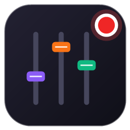
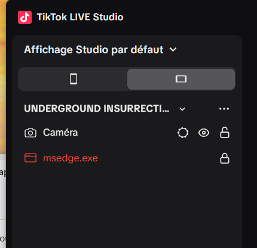
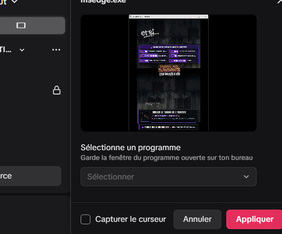
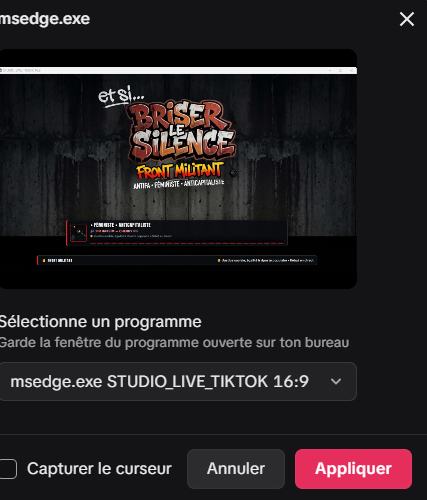
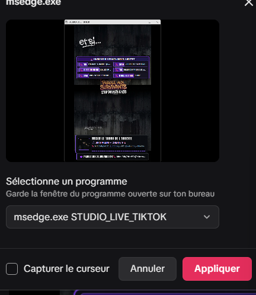

<p align="center"></p>

# 📘 Guide utilisateur — Live Régie

**Live Régie** est la régie de ton live **TikTok LIVE Studio** sur PC. Depuis une seule fenêtre, tu pilotes :
- ce qu'affichent tes scènes : thème du live, titres, fonds, vidéos, articles, sondages ;
- les outils de sécurité : numéros d'aide, bouclier anti-raid, avertissement de sujet sensible ;
- le lien avec ton public : chat, questions épinglées, remerciements, demandes d'aide ;
- le rythme de l'émission : chrono de débat, jingles, journal du live.

> Ce guide explique **comment s'en servir**. Le fonctionnement interne est décrit dans la [documentation technique](DOCUMENTATION_TECHNIQUE_STUDIO_TIKTOK.md).

---

## 1. Avant la première utilisation

**Il te faut :**
- Windows 10 ou 11 ;
- **TikTok LIVE Studio** ;
- **Python** et la bibliothèque **TikTokLive**, pour recevoir le chat dans la régie. Une seule fois, dans un terminal :
  ```
  pip install TikTokLive
  ```
- pour les **sous-titres des vidéos YouTube**, une seule fois aussi :
  ```
  python -m pip install youtube-transcript-api
  ```

**Lancer Live Régie** : double-clique sur le raccourci **Live Régie** (avec le logo) dans le dossier du projet.
- Pour l'avoir aussi sur le Bureau, lance une fois `tools\creer_raccourci.ps1 -Bureau` (clic droit → *Exécuter avec PowerShell*).
- Une seule régie peut être ouverte à la fois. Si tu la relances, l'ancienne est fermée proprement.

---

## 2. Brancher les scènes dans TikTok LIVE Studio

La régie affiche tes scènes à des adresses locales, visibles uniquement sur ton PC :

| Scène | Adresse |
| :--- | :--- |
| Scène verticale 9:16 (format TikTok) | `http://127.0.0.1:8765/stage` |
| Scène paysage 16:9 | `http://127.0.0.1:8765/stage_16_9` |
| Fenêtre revue de presse | `http://127.0.0.1:8765/article` |
| Fenêtre numéros d'urgence | `http://127.0.0.1:8765/urgences` |

**Dans TikTok LIVE Studio** :
- si ta version propose une source de type **lien / page web**, colle directement l'adresse de la scène ;
- sinon, ouvre l'adresse dans Chrome ou Edge, puis ajoute une source **Capture de fenêtre** sur cette fenêtre. Le bouton 🪟 de la régie ouvre les scènes pour toi.

**Les fenêtres de scène** s'ouvrent toutes seules au lancement, et quand tu changes de format. Dans la liste de TikTok LIVE Studio, elles s'appellent :
- `STUDIO_LIVE_TIKTOK 9:16` pour la scène verticale ;
- `STUDIO_LIVE_TIKTOK 16:9` pour la scène paysage.

Le plus simple est de créer une source **Capture de fenêtre** pour chacune. Quand tu changes de format, la source correspondante retrouve sa fenêtre toute seule.

> ⚠️ **Ne réduis jamais une fenêtre de scène** dans la barre des tâches. Une fenêtre réduite ne peut pas être capturée, et elle disparaît de la liste de TikTok. Laisse-la derrière TikTok LIVE Studio. Si elle est réduite, la régie affiche un bandeau orange avec un bouton **Afficher la scène**.

**La fenêtre musique** (`MUSIQUE_LIVE_TIKTOK`, pochette + titre en cours) s'ajoute aussi en **Capture de fenêtre**.

> 💡 La régie doit rester ouverte pendant le live : c'est elle qui fait vivre les scènes. Tu peux la réduire.

### Pas à pas : ajouter (ou réparer) la scène dans TikTok LIVE Studio

**1. Choisis l'orientation dans TikTok.** En haut du panneau des sources, TikTok LIVE Studio a son propre interrupteur **📱 portrait / ▭ paysage**. Chaque orientation a **ses propres sources** :
- en **📱 portrait**, ajoute la scène **9:16** ;
- en **▭ paysage**, ajoute la scène **16:9**.

Bascule ensuite la régie sur le même format (bouton 9:16 / 16:9 en haut de la régie), pour que la bonne fenêtre soit ouverte.

**2. Repère une source perdue.** Une source affichée **en rouge** (ici `msedge.exe`) signifie que TikTok **ne trouve plus la fenêtre** : elle a été fermée, réduite, ou son nom a changé (par exemple après une mise à jour de Live Régie). Clique dessus pour la réparer.

<p align="center"></p>

**3. Choisis le programme.** Dans la fenêtre qui s'ouvre, déroule **« Sélectionne un programme »**.

<p align="center"></p>

**4. Prends la fenêtre qui porte le bon format**, `msedge.exe STUDIO_LIVE_TIKTOK 16:9` (ou `… 9:16` en portrait). L'aperçu doit montrer ta scène. Laisse **« Capturer le curseur »** décoché, puis clique **Appliquer**.

<p align="center"></p>

> ⚠️ **Ne choisis pas une fenêtre nommée seulement `STUDIO_LIVE_TIKTOK`**, sans « 9:16 » ni « 16:9 ». C'est une ancienne fenêtre de scène, ouverte avant la mise à jour, qui se fermera au prochain changement de format. Ferme-la, ou relance Live Régie.
>
> <p align="center"></p>

**5. Garde la fenêtre de scène ouverte**, comme TikTok le rappelle (« Garde la fenêtre du programme ouverte sur ton bureau ») : derrière TikTok LIVE Studio, **jamais réduite**. Si elle est réduite, la régie affiche un bandeau orange **Afficher la scène**.

---

## 3. Tour de la régie

### La barre du haut (toujours visible)
- **🛡️ BOUCLIER ANTI-RAID (F8)** : le bouton d'urgence en cas d'attaque dans le chat (voir §5).
- **LIVE RÉGIE v2.5.0** : le nom et la version.
- **Les voyants** à côté :
  - **● Chat** (vert) ou **○ Chat** (gris) indique si le chat est connecté ; le détail s'affiche au survol, et **un clic sur ○ Chat lance la connexion** ;
  - **🆘 N** (rouge) apparaît quand des demandes d'aide sont à traiter ; un clic ouvre le Bilan.
- **Format** : bascule entre les scènes 9:16 et 16:9.
- **Mode Mini** : une petite fenêtre avec l'essentiel, à garder dans un coin de l'écran.
- **Les boutons de branches** (💜 VSS & Inceste, ✊ Politique, 🎸 Musique, ☕ Chill…) changent le thème du live. Les 3 premiers ont les raccourcis **F9, F10, F11**.
- **Les boutons rapides** (violets ou colorés quand c'est affiché) :
  - **[!] Urg.**, **[TW]**, **[VID]** : afficher / masquer les numéros d'urgence, l'avertissement de sujet sensible et la vidéo ;
  - **Lecteur** : afficher / masquer le lecteur musique des scènes (pochette, titre, artiste) ;
  - **Barre** : afficher / masquer la petite barre d'infos tout en bas des scènes ;
  - **🎵 Jukebox** : ouvre la fenêtre musique séparée.

### Les onglets
| Onglet | À quoi il sert |
| :--- | :--- |
| **🔴 Direct** | Pendant le live : chrono de débat, branche active, textes de la scène, sons et jingles |
| **🖼️ Contenus** | Ce que tu montres : vidéo (YouTube ou fichiers), annonce, revue de presse, musique en cours |
| **👥 Public** | Ton public : chat et questions épinglées, jukebox, sondages, jauge de likes |
| **📝 Bilan** | Demandes d'aide à recontacter, journal du live |
| **⚙️ Réglages** | Tout ce qui se configure une fois : branches, mise en page des scènes, sécurité (numéros d'urgence, avertissement), remerciements, comptes TikTok, auto-tappeur |

> 💡 La règle : les quatre premiers onglets servent **pendant** le live ; tout ce qui se règle à l'avance est dans **⚙️ Réglages**, rangé en volets que tu ouvres d'un clic.

---

## 4. Préparer un live (check-list)

1. Lance **Live Régie**, puis **TikTok LIVE Studio**, et vérifie que les scènes s'affichent.
2. Le chat **se connecte tout seul** au lancement de la régie dès que ton pseudo est renseigné (onglet **👥 Public**, champ « Pseudo TikTok »). Sinon, clique **⚡ Connecter au Live** ou le voyant **○ Chat** en haut.
   - Tu peux le faire **avant** de démarrer le live : la régie se connectera toute seule dès que tu seras en direct.
3. Choisis la **branche** du jour dans la rangée du haut.
4. Si le sujet est sensible, active **[TW]** (avertissement) et vérifie les **numéros d'urgence** (**[!] Urg.**).
5. Clique sur **👁 Aperçu** (bloc Remerciements) pour vérifier que la bulle s'affiche bien sur ta scène.

---

## 5. Pendant le live

### Changer de thème (branche)
Clique sur une branche en haut, ou appuie sur **F9 / F10 / F11**. Le fond, les couleurs, le titre et les textes changent d'un coup.
- Sur une branche comme VSS, les numéros d'urgence s'affichent automatiquement : c'est réglable par branche.
- **Branche active** (onglet Direct) :
  - **↺ Remettre les textes par défaut** annule tes modifications de textes ;
  - **💾 Garder les textes actuels comme défaut** fait de tes textes actuels les textes de la branche.

### Donner la parole : le chrono de débat
Onglet **🔴 Direct** → **⏱️ CHRONO DE DÉBAT** :
- écris le nom de la personne (facultatif), puis clique **▶ 1 min**, **▶ 3 min** ou **▶ 5 min** ;
- en cours de route : **+30 s**, **⏸ Pause** / **▶ Reprendre**, **⏹ Stop** ;
- sur la scène, la pastille passe à l'**orange** à 30 s, puis au **rouge** à 15 s. Un **gong** discret sonne à la fin.

### En cas de raid ou de dérapage : le bouclier
Appuie sur **F8** (ou sur le gros bouton rouge) :
- la scène est entièrement **masquée** par un écran « Pause modération », avec les numéros d'aide ;
- le chat ne peut plus déclencher de sons ni épingler de messages ;
- tu peux changer le message du bouclier dans la régie ;
- appuie de nouveau sur **F8** pour reprendre.

> Les demandes d'aide du chat restent prises en compte même pendant le bouclier.

### Mettre une question en avant
- **F2** épingle la **dernière question** posée dans le chat (un message avec un « ? »). Rappuie pour la retirer.
- Tu peux aussi épingler n'importe quel message depuis l'onglet **👥 Public** (bouton **📌**).
- Les spectateurs peuvent proposer une question en écrivant `!question`.

### Remercier ton public
Les remerciements sont **automatiques** : une bulle « 💜 Merci @pseudo pour 5 × Rose ! » apparaît pour les cadeaux, les partages et les follows.
- Une série de cadeaux ne donne qu'une seule bulle, avec le total.
- Tu peux tout couper avec la case **Remerciements auto** (⚙️ Réglages → Remerciements automatiques).

### Les demandes d'aide 🆘
Quand quelqu'un écrit un mot comme « aide », « 119 », « 3919 » ou « urgence » :
- les numéros d'aide s'affichent ;
- le message est noté dans **🆘 DEMANDES D'AIDE** (onglet 📝 Bilan). Un voyant rouge **🆘 N** apparaît aussi dans la barre du haut : un clic ouvre le Bilan. Cette liste est **privée** : elle n'apparaît jamais sur le live.
- **📋** copie le pseudo, pour retrouver la personne sur TikTok après le live. **✅ Traité** la marque comme traitée.

### Sons, vidéos, articles, sondages
- **Sons** : onglet **🔴 Direct**, bloc **Sons & jingles**. **F1** lance la sirène.
- **Vidéo** : onglet **🖼️ Contenus**. Colle un lien YouTube ou choisis une vidéo de ton PC. **F12** l'affiche ou la masque.

### Sous-titres des vidéos
Onglet **🖼️ Contenus**, sous le bouton d'affichage de la vidéo, choisis l'**affichage** :
- **🎬 Vidéo seule** : comme avant ;
- **🎬 Vidéo + sous-titres** : la vidéo, et un encart de sous-titres en gros caractères ;
- **🔊 Son + sous-titres** : l'image de la vidéo disparaît du live, le son continue, et l'encart affiche les sous-titres avec « 🔊 En écoute ». Pratique pour un témoignage dont tu ne veux pas montrer l'image.

D'où viennent les sous-titres :
- **Vidéo YouTube** : récupérés automatiquement. **Langue** : « fr » par défaut ; tu peux en mettre plusieurs par ordre de préférence (« fr,en »). Sans sous-titres dans ta langue, ceux de la langue parlée dans la vidéo sont utilisés.
- **Vidéo de ton PC** : pose un fichier de sous-titres **du même nom** à côté de la vidéo (`temoignage.mp4` + `temoignage.srt`, ou `.vtt`).

Le **témoin** sous ces réglages dit, dès que tu choisis la vidéo, si des sous-titres ont été trouvés (✅), s'il n'y en a pas (⚪) ou si YouTube a refusé la demande (❌).

**⚠️ Sous-titres dans une autre langue** : beaucoup de vidéos n'ont que des sous-titres anglais. Le français vient alors d'une **traduction automatique** (YouTube, ou Google Traduction si le module facultatif `deep-translator` est installé). Ces services la refusent parfois pendant un moment : le témoin passe en orange, les sous-titres s'affichent dans la langue d'origine, et la régie **réessaie toute seule toutes les 5 minutes**. Une fois la traduction obtenue, elle est **gardée en mémoire** pour les prochains lives. Le bouton **🔄 Recharger** relance la recherche tout de suite (utile aussi après avoir posé un fichier `.srt`).

Pour être sûr d'avoir du français pendant le live, lance la vidéo dans la régie **quelques heures avant** : si la traduction est refusée sur le moment, elle a le temps d'arriver et d'être gardée.

L'encart des sous-titres se **déplace et s'étire** comme les autres : le texte grandit avec sa largeur. Réglage **Taille** en plus. Les boutons lecture, pause et ±10 s de la régie marchent maintenant aussi pour les vidéos YouTube.
- **Article** : onglet **🖼️ Contenus**, volet **Revue de presse**. Colle le lien, clique **🪄 Extraire**, puis ouvre la fenêtre dédiée.
- **Sondage** : onglet **👥 Public**. Écris la question et les choix ; les spectateurs votent en tapant `!1`, `!2`, `!3` ou `!4`.
- **Encart d'annonce** : onglet **🖼️ Contenus**, bloc **Annonce**. Écris ton message, et **F4** l'affiche ou le masque.

### Placer et redimensionner les encarts
Directement sur la scène, ouverte dans le navigateur ou dans TikTok LIVE Studio :
- **glisse** un encart pour le déplacer ;
- tire ses **bords ou son coin** pour le redimensionner.

Le contenu suit automatiquement :
- l'annonce, les numéros d'urgence, l'avertissement et la question épinglée **grossissent ou rétrécissent** pour remplir le cadre, sans jamais déborder ;
- la grille des numéros passe sur 1, 2 ou 3 colonnes selon la largeur ;
- la vidéo occupe tout son encart.

La disposition est **enregistrée par Live Régie** : tu retrouves la même dans TikTok LIVE Studio et dans le navigateur, même après une relance.

Réglages dans **⚙️ Réglages → 🖼️ Mise en page des scènes** :
- ajustement automatique activé ou non ;
- vidéo en « Cadre entier » ou en « Remplir » ;
- **↺ Réinitialiser la mise en page**, qui remet tous les encarts à leur place d'origine sur toutes les scènes.

### Si le chat se coupe
Pas besoin de toucher à quoi que ce soit : la régie **se reconnecte toute seule**. Le statut du chat indique « nouvelle tentative dans N s ».

---

## 6. Après le live

Onglet **📝 Bilan** → **📝 JOURNAL DU LIVE** → **🏁 Terminer le live & enregistrer le journal**.

Un fichier est créé dans le dossier `journaux/` (bouton **📂 Dossier**). Il contient :
- la durée et les chiffres : commentaires, cadeaux, partages, follows, demandes d'aide ;
- la chronologie : thèmes, chronos, bouclier, questions épinglées, sondages ;
- la liste des **demandes d'aide** de ce live, pour recontacter les personnes.

> 🔒 Ce fichier contient des messages de personnes vulnérables : il reste sur ton PC et n'est **pas** envoyé sur GitHub.

---

## 7. Raccourcis clavier

Ils fonctionnent même si la régie est réduite ou si tu es dans une autre fenêtre.

| Touche | Action |
| :--- | :--- |
| **F1** | Sirène (jingle alerte) |
| **F2** | Épingler / retirer la dernière question |
| **F3** | Afficher / masquer les numéros d'urgence |
| **F4** | Afficher / masquer l'encart d'annonce |
| **F8** | Bouclier anti-raid |
| **F9 / F10 / F11** | 1re / 2e / 3e branche |
| **F12** | Afficher / masquer la vidéo |

> ⚠️ Comme ils sont globaux, appuyer sur F1 dans une autre application déclenche aussi la sirène.

---

## 8. Personnaliser

### Les branches (thèmes du live)
Onglet **⚙️ Réglages** → volet **🎛️ Branches du live**. Ouvre une branche pour régler :
- le **nom du bouton** (avec emoji) et les **couleurs** ;
- l'étiquette et le titre affichés sur la scène, le sujet et le sous-titre par défaut ;
- le mode du bandeau, et l'affichage automatique des numéros d'urgence ;
- les **fonds d'écran** 9:16 et 16:9 (**📂 Choisir…**).

Tu peux aussi **➕ Ajouter** une branche, **⬆ Monter** pour changer l'ordre (et donc les raccourcis F9 à F11) ou **🗑 Supprimer**.

Rien n'est appliqué avant **💾 Enregistrer**. **Annuler** abandonne les modifications.

### Le bot du chat
Onglet **👥 Public** → **⚙️ Configurer le Bot…** : mots-clés d'urgence, mots interdits (filtre anti-insultes), commandes qui épinglent ou lancent un son.

### Les numéros d'urgence
Onglet **⚙️ Réglages** → volet **🛡️ Sécurité** → **⚙️ Configurer les Numéros d'Urgence…**. Le texte de l'avertissement de sujet sensible se règle au même endroit.

Réglages d'affichage de l'encart, dans le volet **🛡️ Sécurité** :
- **Taille du texte** (60 à 250 %) : agrandit les numéros, les descriptions et le titre.
- **Colonnes** : **Auto** met autant de colonnes que la largeur de l'encart le permet ; 1 à 4 impose le nombre.
- **Descriptions en entier** : la description passe à la ligne au lieu d'être coupée par « … ».
- **Emplacement 16:9** (Gauche, Droite, Bandeau haut) : replace l'encart à cet endroit, à sa taille de départ. Un nouveau clic sur le même bouton remet l'encart en place.

Sur la scène, **étire l'encart par ses bords gauche, droit ou bas**, ou par le coin. Si l'ajustement automatique est activé (Mise en page des scènes), le texte grandit avec le cadre.

### Les jingles
Onglet **🔴 Direct** → bloc **Sons & jingles** → **➕ Ajouter Jingle**, en MP3 ou en vidéo.

---

## 9. En cas de souci

| Problème | Solution |
| :--- | :--- |
| Les scènes sont vides ou « introuvables » | Vérifie que Live Régie est ouverte, puis recharge la source dans TikTok LIVE Studio. |
| La source `msedge.exe` est **en rouge** dans TikTok | TikTok a perdu la fenêtre de scène : clique sur la source, choisis `STUDIO_LIVE_TIKTOK 9:16` ou `16:9`, puis **Appliquer** (voir §2, pas à pas). |
| Je ne trouve pas ma scène dans la liste des programmes | Elle est sans doute réduite : clique **Afficher la scène** dans la régie. Vérifie aussi que la régie est sur le même format que l'orientation de TikTok (📱 = 9:16, ▭ = 16:9). |
| Le chat ne se connecte pas | Vérifie le pseudo (sans faute) et que tu es bien en live. « Module TikTokLive non installé » : lance `pip install TikTokLive`. |
| « Compte introuvable » | Le pseudo est mal orthographié : corrige-le et reconnecte. |
| Une question s'épingle toute seule | L'option « épingler automatiquement les questions » est activée dans la config du bot. |
| La scène ne change qu'en revenant sur sa fenêtre | Mets Live Régie à jour (2.2.1 ou plus) : la scène est maintenant ouverte dans un Edge dédié qui ne se met pas en veille derrière TikTok. |
| Un raccourci ne marche pas | Une autre application utilise peut-être la même touche. Ferme-la ou utilise le bouton dans la régie. |
| Je veux revenir aux thèmes d'origine | ⚙️ Réglages → Branches du live → **🔄 Rétablir les 4 branches d'origine** → **💾 Enregistrer**. |

---

## 10. Confidentialité

- Les scènes et la régie ne fonctionnent **que sur ton PC** (adresse `127.0.0.1`).
- Les **demandes d'aide** et le **journal** ne sont jamais affichés sur le live, ni envoyés sur GitHub.
- L'auto-tappeur (⚙️ Réglages → Comptes TikTok et auto-tappeur) automatise des tapotements : c'est **contraire aux règles de TikTok**, et ton compte peut être restreint si tu t'en sers.
